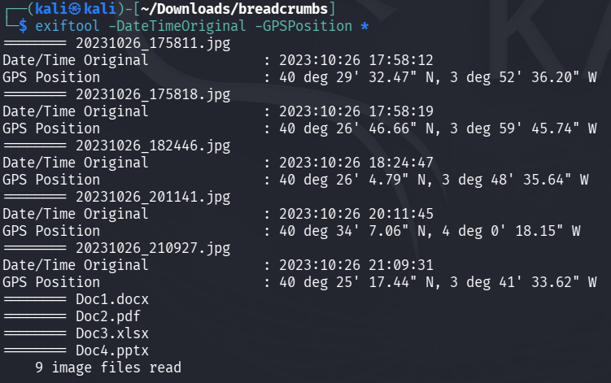

# BreadCrumbs · Análisis de metadatos (OSINT)

> Cinco fotografías y ninguna pista visible: con ExifTool, sus metadatos revelan **dónde y cuándo** se tomó cada una, y juntas reconstruyen el recorrido de una tarde. Las "migas de pan" que dan nombre al reto.


## Contexto

| | |
|---|---|
| **Reto** | BreadCrumbs |
| **Plataforma** | ThePwnLab · *The Breach*, powered by The Bridge |
| **Formación** | Bootcamp de Ciberseguridad de The Bridge |
| **Categoría** | OSINT |
| **Completado** | 30 de septiembre de 2026 |
| **Material analizado** | 5 fotografías `.jpg` y 4 documentos (`.docx`, `.pdf`, `.xlsx`, `.pptx`), desde Kali Linux |

## Las migas de pan

Un solo comando extrae la fecha de captura y la posición GPS de todos los archivos:

```bash
exiftool -DateTimeOriginal -GPSPosition *
```



Ordenadas por hora, las fotografías del 26 de octubre de 2023 forman un recorrido:

| Hora | Fotografía | Coordenadas GPS | Ubicación | Flag |
|---|---|---|---|---|
| 17:58:12 | `20231026_175811.jpg` | 40°29'32.47" N, 3°52'36.20" W | Las Rozas de Madrid | 1 |
| 17:58:19 | `20231026_175818.jpg` | 40°26'46.66" N, 3°59'45.74" W | Calle Paraguay | 2 |
| 18:24:47 | `20231026_182446.jpg` | 40°26'4.79" N, 3°48'35.64" W | — | — |
| 20:11:45.382 | `20231026_201141.jpg` | 40°34'7.06" N, 4°0'18.15" W | — | 3 (hora exacta) |
| 21:09:31 | `20231026_210927.jpg` | 40°25'17.44" N, 3°41'33.62" W | The Bridge (antigua sede) | 4 |

Los cuatro documentos no contienen fecha de captura ni coordenadas GPS.

**Informe completo, paso a paso:** [reporte-de-metadatos.md](reporte-de-metadatos.md)

## Metodología

| Paso | Comando |
|---|---|
| Revisar qué etiquetas ofrece la herramienta | `man exiftool` |
| Fecha y GPS de todos los archivos a la vez | `exiftool -DateTimeOriginal -GPSPosition *` |
| Latitud y longitud de una foto concreta | `exiftool -GPSLatitude -GPSLongitude <archivo>` |
| Todos los metadatos (incluidos los milisegundos) | `exiftool <archivo>` |
| Convertir coordenadas en un lugar | Google Maps |

## Lecciones

- **Una foto cuenta más de lo que se ve.** Sin abrir ninguna imagen, los metadatos dicen dónde estaba alguien y a qué hora, con precisión de metros y milésimas de segundo.
- **Juntas, las fotos son un patrón de vida.** Cada imagen aislada es un dato; cinco ordenadas por hora son un itinerario. Así funciona el OSINT: correlacionar piezas pequeñas.
- **Los metadatos no son una verdad absoluta.** En las fotografías del reto, las dos primeras están separadas por **7 segundos**, pero a más de 10 km de distancia: físicamente imposible. Lo más probable es que las coordenadas se asignaran a mano al preparar el ejercicio, ya que cualquiera puede editar los metadatos con la misma herramienta que los lee. En una investigación real, una incoherencia así obliga a contrastar los datos con otras fuentes antes de darlos por buenos.
- **Defensa:** eliminar los metadatos antes de publicar una imagen (por ejemplo, `exiftool -all= foto.jpg`) y desactivar la geolocalización de la cámara cuando no haga falta.

## Nota

El análisis y las capturas de pantalla son trabajo propio. Los archivos del reto no se incluyen en el repositorio.
