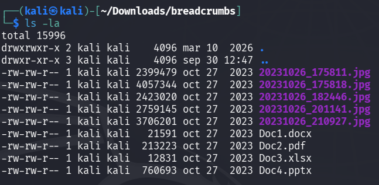
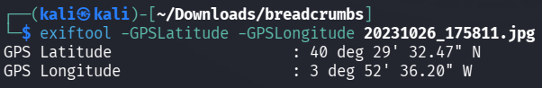
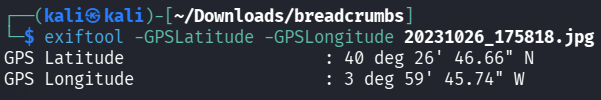
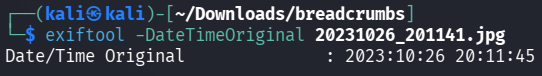
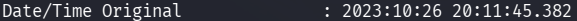
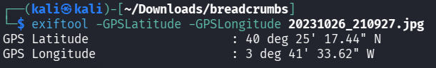

# BreadCrumbs — Reporte de metadatos

#### Descargar el .zip en Kali, descomprimirlo, verificar las imágenes del archivo breadcrumbs y responder las Flags del reto.


#### 1º Paso - Visualizar información

```
man exiftool 
```
*Buscar por GPS y fecha de captura*
#### 2º Paso - Comando de filtrado

```
exiftool -DateTimeOriginal -GPSPosition *
```


#### 3º Paso - Comando GPS Latitud y Longitud

```
exiftool -GPSLatitude -GPSLongitude [nombre_archivo.jpg]
```

#### 4º Paso - Primera Flag



```
40º29'32.5"N 3º52'36.2"W  - Las Rozas de Madrid
```
*Google Maps*

#### 5º Paso - Segunda Flag



```
40º26'46.66"N 3º59'45.74"W - Calle Paraguay
```
*Google Maps*

#### 6º Paso - Tercera Flag

```
exiftool -DateTimeOriginal 20231026_201141.jpg
exiftool 20231026_201141.jpg
```
*Se usaron ambos comandos para la búsqueda de la fecha y hora exacta de la captura en 
AA:MM:DD HH:MM:SS.MS*

```
2023:10:26 20:11:45.382
```




#### Último paso - Cuarta Flag



```
40º25'17.44"N 3º41'33.62"W - The Bridge | Digital Talent Accelerator
```
*Localización de la empresa donde tuvo su última sede*
